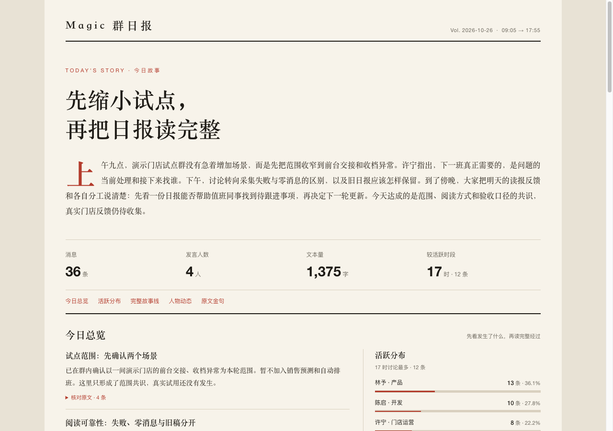

<p align="center">
  
</p>

# Magic 微信群日报

**把群里的讨论整理成可以回看的日报。**

Magic 微信群日报是一个运行在 Windows WorkBuddy 上的 Skill。选择想关注的微信群后，它可以按照你设定的时间，为每个群分别整理日报。

你可以通过日报了解群里的主要话题和待确认事项，也可以按日期、群聊或关键词回看过去的讨论。

**Windows · WorkBuddy · 1.3.0-rc.9 测试候选**

[复制安装提示词](#安装与更新) · [候选版与下载](https://github.com/fxbillu/Magic-wechat-group-daily-skills/releases/tag/v1.3.0-rc.9) · [Windows 试用说明](skills/wechat-group-daily/references/windows-acceptance.md)

## 为什么做这个项目

每天打开微信，多个项目群的消息一条接一条。讨论过什么、哪些事情有了进展、哪些还在等回复，过几天再找，往往需要翻很久。

做这个项目，是想把关注群里的讨论整理成可以回看的日报，方便自己梳理信息，也为项目进度同步提供素材。

目前开源的是**微信群日报部分**，包括按群生成日报、阅读、历史回看和搜索；更完整的项目进度整合与同步不在本次开源范围内。日报反映的是群内讨论，项目的实际进展和完成情况仍需相关负责人确认。

## 能做什么

- **选择关注的群。** 在 WorkBuddy 对话中确认微信账号和关注群；遇到同名群时，可以区分并选择正确的群聊。
- **阅读各群日报。** 每个群独立成篇，可以查看主要话题、待确认事项、人物动态和原文引用，结合来源核对讨论内容。日报提供 HTML，也可以在环境支持时生成 PNG。
- **回看过去的讨论。** 按日期查看多个群，按群查看历史，也可以组合日期、群聊和关键词搜索，并查看搜索结果的前后文。
- **保留已有内容。** 重新采集后仍保留可读的旧稿；旧版历史 HTML 沿用原有排版，可以单独打开阅读。

## 界面示例

<a href="assets/readme/daily-overview.png"></a>

*多群日报列表。截图来自合成数据浏览检查，用于展示界面，不代表真实微信群或 Windows 运行结果。点击图片可查看原图。*

<a href="assets/readme/overview-first.png"></a>

*日报开场与总览，由正式渲染器生成；示例中的人员和群聊均为虚构。*

开发分支新增按群选择的“详细版／项目工作版”，工作版重点整理总结、任务、责任人和期限；后台出报改为只通知链接。尚未进入已发布安装包，见 [模板与 Windows 验收说明](skills/wechat-group-daily/references/report-templates.md)。

开发分支新增语音转写（尚未进入已发布安装包），可按需配置本地 Whisper：转写文字进入归档和日报，失败项标明并支持补跑；转完清理运行资源与临时音频，保留模型缓存。见 [语音转写说明](skills/wechat-group-daily/references/voice.md)。

## 安装与更新

在 Windows 上打开 WorkBuddy，把下面这段话发给它，再按照提示完成配置。首次处理数据前，请先阅读[使用边界与数据处理](#使用边界与数据处理)，确认自己有权处理相关群聊。

```text
请帮我安装并使用这个项目：
https://github.com/fxbillu/Magic-wechat-group-daily-skills

按照仓库说明加载微信群日报 Skill，带我检查环境，确认微信账号、关注群、数据保存位置和时间设置，并生成、打开首份日报。首报可读后，再协助我配置每日任务。

如果已经安装，请更新程序，并保留原配置和历史。
```

也可以从[候选版页面](https://github.com/fxbillu/Magic-wechat-group-daily-skills/releases/tag/v1.3.0-rc.9)下载 ZIP，导入 WorkBuddy。安装、加载与更新的详细步骤见 [Skill 安装说明](skills/wechat-group-daily/references/install-and-update.md)。

### 第一次使用

首次建议先选择 1—2 个群，确认账号、群聊、时区和数据保存位置，再尝试生成一份日报。

打开实际生成的 HTML，看看主要话题、引文和发言人是否准确。无消息、素材不足和采集失败会分别说明，可以根据结果决定下一步。

首报可读后，再创建或更新 WorkBuddy 本地定时任务，并核对任务的时间和工作空间。详细步骤见[每日任务配置与复建指引](skills/wechat-group-daily/references/scheduling.md)。

### 桌面快捷方式

Windows 初始化并保存配置后，程序会尝试在桌面创建带报纸图标的 **Magic 群日报** 快捷方式。创建成功后，双击即可启动或复用本地阅读服务；程序会优先使用 Edge 或 Chrome 的独立窗口打开。

重复初始化或恢复时会更新同一个入口。快捷方式创建失败不会撤销已保存的配置，可以让 WorkBuddy 按[安装说明](skills/wechat-group-daily/references/install-and-update.md)重建；未初始化时也可以打开阅读指引。快捷方式和图标留在本机，不会上传到 GitHub。

### 以后怎么更新

对 WorkBuddy 说 **“更新 Magic 微信群日报”**。Skill 会按照本机安装记录更新程序，保留个人配置、历史和已有任务；如遇本地改动或其他问题，再按提示处理。

## 日报什么时候生成

你可以选择每天开始整理的时间，建议时间为 21:00。每个关注群每天最多生成一份日报；时间指的是任务开始执行，并不保证在该时刻完成。

每次整理会从该群上次成功处理的截止时间接续，到本次计划截止时间为止。首次使用时，会结合关注时间和已有历史确定起点。实际起止时间会写在日报报头；截止之后的消息留到下一份。失败后重试会复用原来的时间范围，无消息或素材不足时会如实说明，不会凭空补写内容。

定时运行时，电脑需要开机、不休眠，WorkBuddy 保持运行并联网，微信数据也需要能够按本机现有流程读取。**手动试跑成功和实际到点运行成功是两回事**，建议在首次到点后查看任务记录和日报结果。

如果之前配置过任务，请按[任务指引](skills/wechat-group-daily/references/scheduling.md)更新原有任务，并检查旧任务，避免重复运行。一个任务即可处理所有已确认的关注群；阅读器用于查看日报，配置和定时任务在 WorkBuddy 中处理。

## 使用边界与数据处理

1. **只处理有权处理的数据。** 在本人设备上使用本人账号，确认群聊导出、分析、向模型提供及分享所需的权限，并遵守群内约定和组织的数据管理要求。不得未经授权访问他人数据，也不得利用数据侵害他人权益。
2. **本机归档与解密范围不同。** 配置、密钥、解密数据库、归档和日报保存在本机程序包以外的位置。日报归档只保存所选群指定时间范围的消息；底层按共享数据库分片解密，因此本机明文数据库可能包含其他会话。历史文件不会自动到期删除，备份与清理方式见[完整说明](skills/wechat-group-daily/DISCLAIMER.md#本机保存与模型处理)。
3. **本机保存不代表全程离线。** WorkBuddy 整理日报时，聊天内容或片段可能发送至云端模型服务；传输、留存和使用方式以所用服务的条款与设置为准。处理前请确认相应权限和数据处理方式。
4. **分享和反馈前脱敏。** 聊天、日报和截图可能包含成员身份、联系方式或保密信息。分享前请取得必要授权并脱敏；反馈问题时不要提交密钥、个人配置、原始数据库或未经处理的聊天记录。

## 当前验证范围

当前版本 **1.3.0-rc.9** 是 Windows 测试候选。开发侧已完成程序、界面和安装包检查，其中界面和功能检查使用合成数据；rc.9 仅更新使用边界与免责声明，运行代码沿用 rc.8。此前完整检查中有一项可选 Pillow 检查跳过。

**Windows 真实微信取数、模型首报、PNG 和实际到点执行，仍需由使用者在本机验证。** 安装后，请以真实取数、打开日报和历史回看等实际结果判断是否可用。WAL 目前仅作为诊断记录，其覆盖情况仍需在 Windows 上核实。

检查范围和证据见 [rc.9 验证记录](docs/verification/1.3.0-rc.9.md)、[rc.8 验证记录](docs/verification/1.3.0-rc.8.md)、[rc.7 验证记录](docs/verification/1.3.0-rc.7.md)和 [rc.6 页面联调记录](docs/verification/1.3.0-rc.6.md)。如需逐步试用或反馈结果，请参考 [Windows 试用说明](skills/wechat-group-daily/references/windows-acceptance.md)。

## 免责声明

完整 [使用边界、数据处理与免责声明](skills/wechat-group-daily/DISCLAIMER.md) 已随安装包提供，可离线阅读。

本项目是独立的社区项目，非微信、WeChat 或 WorkBuddy 官方产品，与腾讯及相关服务提供方无隶属或背书关系。相关名称和商标归各自权利人所有。数据读取方式受[微信等平台协议](https://oper.my-qcloud.com/cgi-bin/readtemplate?lang=zh_CN&s=default&t=weixin_agreement)约束，本项目不提供平台授权，也不保证账号或服务不受限制。

项目按现状提供，在适用法律允许的范围内不作 MIT 许可证所列保证。兼容性、消息完整性、日报准确性和任务执行会受软件版本及运行环境影响。AI 总结可能遗漏或误解，引用、署名、项目状态及重要结论需核对原始消息；人物分析不应作为能力、信誉、性格或绩效评价。

请遵守适用法律法规，妥善保管密钥和本地数据。本说明不增加 MIT 软件许可的限制，不替代数据或平台授权，也不改变各方依法应承担的责任。第三方组件的许可见下文。

## 许可证与第三方来源

本项目自有代码与文档采用 [MIT 许可证](LICENSE)：允许使用、修改、分发和商业使用，须保留版权及许可声明；不提供许可证所列保证。版权标识为 fxbillu and Magic WeChat Group Daily contributors。

第三方组件保留各自版权及许可，见 [NOTICE](NOTICE.md) 和 [来源清单](skills/wechat-group-daily/references/third-party.md)。Vue、wcdb-key-tool 和 WeChatDaily 的 MIT 文本均随包提供；可选语音 pilk 使用 GPLv3，运行库和模型不随包分发，不能把完整语音环境统称为 MIT。软件许可不授予聊天内容、账号、商标或第三方服务的权利。

[来源与开发过程审查](docs/reviews/2026-10-27-license-audit.md) 记录了导入哈希、Git 开发、第三方比对和维护者授权依据；旧电脑上未留存的初始生成记录不能据此补证。rc.7 补齐随包声明与打包检查，保留 rc.6 功能、原配置和历史。

## 开发与文档

正式 Skill：[`skills/wechat-group-daily/`](skills/wechat-group-daily/)；测试仅使用合成数据。

```bash
python3 -B -m unittest discover -s tests -p 'test_*.py' -v
node --check skills/wechat-group-daily/scripts/web/app.js
python3 -B skills/wechat-group-daily/scripts/tools/package.py
```

[产品上下文](PRODUCT.md) · [视觉基线](DESIGN.md) · [读取契约](docs/contracts/read-api-v1.md) · [开发记录](docs/dev-log.md) · [依赖能力](skills/wechat-group-daily/references/dependencies.md) · [第三方来源与许可](skills/wechat-group-daily/references/third-party.md)

个人配置、密钥、聊天、日报及本地导入备份均不进入 Skill ZIP；程序和完整前端按显式清单出包。每位使用者使用自己的数据和任务。
