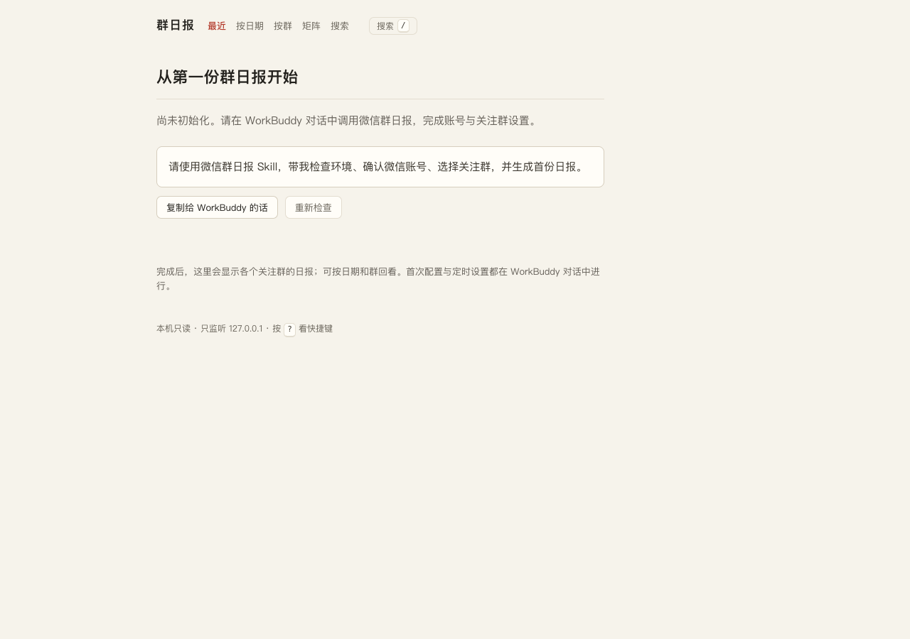
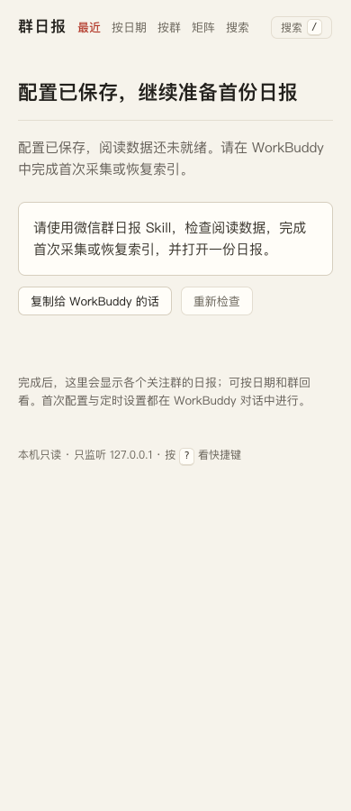
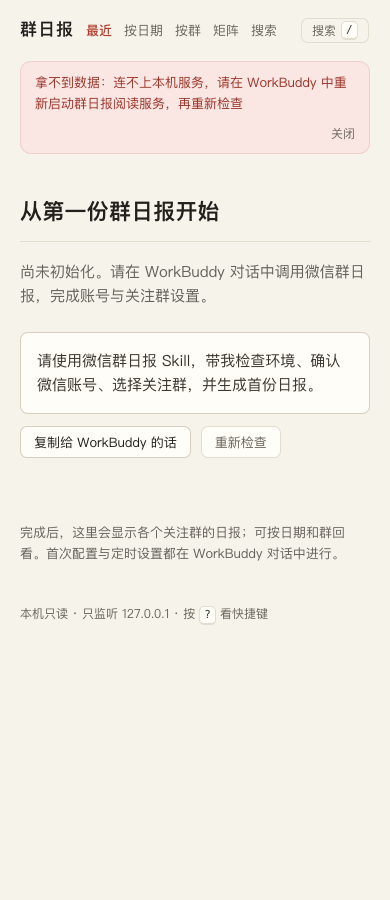

# T0 基线验收记录

整理日期：2026-10-27（Asia/Shanghai）。对应 [T0 Issue #2](https://github.com/fxbillu/wechat-group-daily-skills/issues/2)、[已批准主计划](../plans/2026-10-26-development-plan.md)和[读取接口契约 v1](../contracts/read-api-v1.md)。

**T0 技术验收通过：功能、独立后端复核、实际浏览、规范评审及干净提交导出验证均已完成。** 本轮浏览使用真实 Python 服务与合成包外配置，不使用个人微信记录。范围仅含未配置、配置无效、索引未就绪及连接失败，不代表完整阅读器或旧缺陷已修复。本记录不表示 Issue 已关闭、分支已推送或三个开发对话已创建，这些操作由主控另行收尾。

## 实际浏览与交互

浏览器为 Ego Lite 0.6.0.16。三种正常返回状态各检查 1280 × 900 与 390 × 900，共 **6 次页面加载**。

| 场景 | 页面结果 | HTTP 结果 | 两档宽度结果 |
|---|---|---|---|
| 未配置 | “从第一份群日报开始”，指引返回 WorkBuddy 初始化 | 状态接口 200；阅读接口 503 / `NOT_CONFIGURED` | 标题与操作可见、加载结束、无文档级横向溢出 |
| 配置无效 | “先检查这台电脑的配置”，提示保留数据并修复 | 状态接口 200；阅读接口 503 / `CONFIG_INVALID` | 同上 |
| 已配置但无索引 | “配置已保存，继续准备首份日报”，提示首次采集或恢复索引 | 状态接口 200；阅读接口 503 / `INDEX_NOT_READY` | 同上 |

六次加载均未捕获 JS 错误或未处理拒绝。独立前端浏览代理 `frontend_plan` 目视检查了全部六张正常状态截图及错误、焦点截图，确认文字与控件可见、保留原有纸色阅读风格。主控实际目视检查的是下方保存的三张图：未配置 1280px、无索引 390px、最终断连 390px；本记录整理时也再次查看了这三张图。

- **键盘与剪贴板：** Tab 可到达复制和重新检查控件，焦点有可见的 2px 描边；Enter 触发复制，原生剪贴板内容与合成场景的预期 WorkBuddy 指引一致。
- **重新检查：** 改变合成配置后，页面可从索引未就绪切换为配置无效，再切回索引未就绪，确认重新读取配置。
- **反馈修复：** 发现旧的 `copyNotice` 在重新检查后残留，已修复并复测；390px 下提示清空、加载结束、无横向溢出。
- **断连终态：** 停止本地服务后显示明确错误，指引在 WorkBuddy 重启阅读服务再重新检查；加载结束，`copyNotice` 为空。不会停留在持续加载状态。

核心 Tab/Enter 操作在桌面默认视口执行；390px 另行核验焦点及错误截图。不能据此声称完整阅读器的全部键盘操作已经通过。

## 其他检查与独立复核

| 证据 | 当前结论 | 边界 |
|---|---|---|
| 实施代理的公共 CLI / HTTP 测试 | 7 项通过；嵌套配置与缺损 schema 问题已修复 | 不代替真实 Windows 验证 |
| 独立后端复核 | 两项阻塞修复已复核通过，7 项测试通过 | 覆盖本次配置脱敏与索引只读边界，不代表旧缺陷全部关闭 |
| 独立规范评审 | 发现 1 处非阻塞兼容说明不一致，已纠正；未发现新增维护性问题 | 明确旧 health 的 `web_dir` 已为脱敏移除，读取方使用 `web_ready`，不恢复绝对路径 |
| 主控的干净提交导出验证 | 提交导出的独立临时目录中，Python 隔离模式下 7 项测试通过，JavaScript 语法检查通过 | 不含原始导入区，不依赖父工作区或个人配置 |
| 独立 T0 静态审计报告 | 32 个正式技能源文件未检出所查凭证及本机状态 | 属于本次基线审计，不是正式发布包审计或无泄漏保证 |
| 临时环境清理记录 | 浏览任务空间 28 已结束；三个服务进程均停止，51689、51690、51691 端口已关闭 | 此次浏览没有遗留临时服务 |

浏览记录依据为本轮的 `summary.json`、`browser-results.json`、`ui-fix-recheck.json`。UI 修复复测对应的前端源码 SHA-256 为 `ec0c47d16c26baeba12117a00b803620fc955250acf52373f53f813bfa010904`。原始临时配置、服务日志和聊天内容不进入本证据目录。

正式源码基线已提交于 `codex/wechat-skill-integration`，提交为 `bf0d3bec202a2e9d3216cd354726f343a8653243`。主控从该提交执行 `git archive` 导出到独立临时目录，以 Python `-I -B` 运行 7 项测试，退出码为 0；前端 `node --check` 退出码为 0。脱敏输出保存在[提交导出验证记录](t0-git-archive.json)。此后本轮收尾只更新文档，未再改变代码。

## 可复现入口

从仓库根目录运行。自动测试使用正式源码的临时安装副本、隔离配置和合成夹具，不依赖被忽略的原始导入区；具体字段及读写边界以[契约](../contracts/read-api-v1.md)为准。

```bash
python3 -B -m unittest discover -s tests -p 'test_*.py' -v
node --check skills/wechat-group-daily/scripts/web/app.js
python3 -B skills/wechat-group-daily/scripts/tools/serve.py --port 8765
```

测试入口见 [T0 readiness 测试](../../tests/test_readiness.py)。这组命令不能验证 Windows 微信或 WorkBuddy 的实际兼容性。

## 保存的截图

未配置，1280px：



配置已保存、索引未就绪，390px：



服务断连修复复测，390px：



## 后续验收边界

Windows 真实取钥与微信库/WAL、真实模型写稿、PNG、宿主任务回读与到点触发、第二台 Windows 安装，均未由本记录验证。旧审查的 13 个缺陷按后续票据处理；T0 相关基础修正不等于它们全部关闭。完整 Skill 的白名单分发、升级和最终 ZIP 验收仍属 T5。
